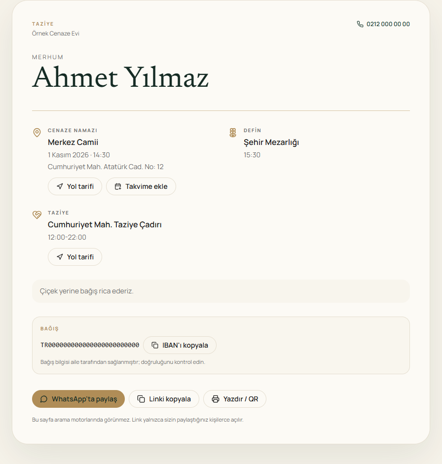
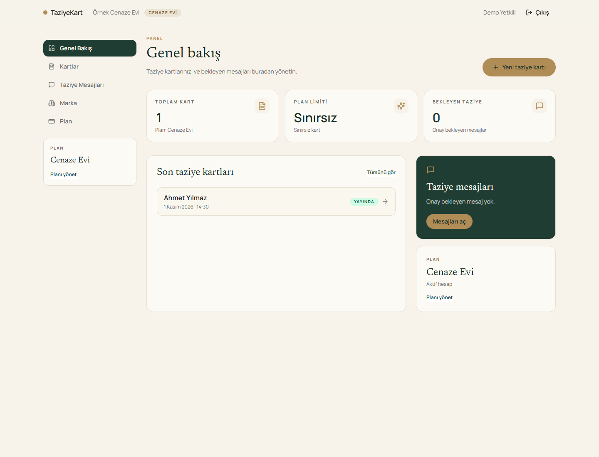
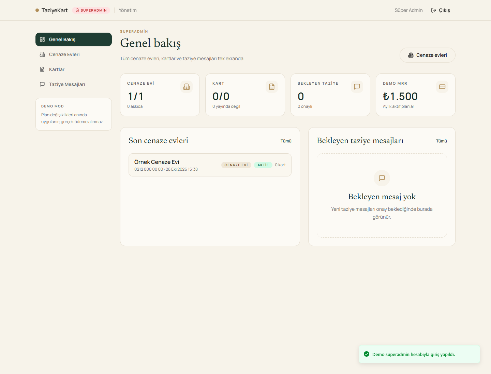
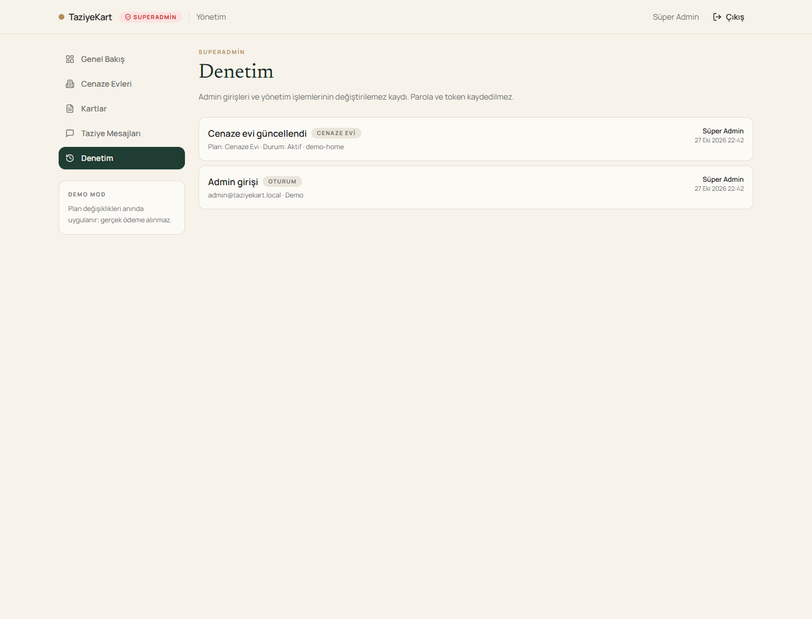

# TaziyeKart

Cenaze evleri için beyaz etiket dijital taziye kartı. Aileye tek bir saygın link verir: cenaze namazı yeri/saati, defin, taziye adresi, yol tarifi, takvim, QR'lı yazdırılabilir kart ve onaylı taziye defteri.

**Aileler ödemez; cenaze evi öder.**

**GitHub:** <https://github.com/GhoSci-Tech/TaziyeKart>

- Tek Kart: 350 TL (tek seferlik)
- Cenaze Evi: 1.500 TL/ay (sınırsız kart, kendi markası)

## Durum

Faz 0-10: dokümanlar, workspace iskeleti, Prisma şeması, seed, gerçek auth, panel/public/edit API'leri, zod doğrulama, plan limitleri, 19 API testi, cenaze evi panel UI, public taziye kartı (OG/WhatsApp, yol tarifi, takvim, taziye defteri, aile düzenleme), A6 QR'lı yazdırma, tam satış sayfası, 90 saniyelik pitch + sessiz test, superadmin paneli, audit log ve güvenlik sertleştirmesi. Giriş, kayıt ve admin girişinde şifre göster/gizle vardır. Faz 10'da deploy rehberi, dört gerçek ürün ekran görüntüsü ve public GitHub reposu tamamlandı.

## Hızlı başlangıç

```powershell
npm install
npm run db:setup
npm run dev
```

- Web: http://localhost:3000
- API: http://localhost:3002/api/health
- Proxy: http://localhost:3000/api/health

> `npm run dev` her başlangıçta `db:setup` çalıştırır. Seed idempotenttir; admin ve demo cenaze evini oluşturur, kart oluşturmaz.

## Siteyi açma

Geliştirme modu:

1. PowerShell aç ve proje klasörüne gir:
   ```powershell
   cd "C:\Users\ENES\Desktop\Çalışma\AI Kursu Ödevler\proje_yarışma_satılabilir"
   ```
2. Başlat:
   ```powershell
   npm run dev
   ```
3. Tarayıcıda **http://localhost:3000** aç.
4. Giriş ekranında **“Demo cenaze eviyle gir”** butonunu kullan veya `demo@taziyekart.local / Demo123!` ile giriş yap.
5. Durdurmak için terminalde `Ctrl+C`.

İlk kurulumda `npm install` ve `npm run db:setup` bir kez çalışır; `npm run dev` zaten `db:setup` adımını içerir.

Production preview (isteğe bağlı):

```powershell
npm run build
npm start
```

Canlı/uzak sunucu adımları: [`docs/DEPLOY.md`](docs/DEPLOY.md). Yarışma/jüri için local çalıştırma yeterlidir.

### Public kartı deneme

1. Panelde bir taziye kartı oluştur.
2. Kart detayındaki **Public link** satırında **Aç**'a bas.
3. Public URL: `http://localhost:3000/k/<slug>`
4. Aile düzenleme linki: `http://localhost:3000/duzenle/<token>` (yalnızca aileyle paylaş).
5. Public sayfada taziye mesajı bırak → panelde **Taziye Mesajları → Onayla** → public sayfayı yenile.

Public sayfada yol tarifi, Google Takvim, WhatsApp paylaşımı, link kopyalama, yazdırma ve taziye defteri vardır. A6 QR baskı hazır: public kartta **Yazdır / QR** → A6 ön/arka → **Yazdır → PDF olarak kaydet**.

### Admin paneli

1. `http://localhost:3000/admin/giris` aç.
2. **Demo admin olarak gir** veya `admin@taziyekart.local / Admin123!` ile giriş yap.
3. Dashboard’dan cenaze evleri, kartlar, taziye mesajları ve plan/askıya alma işlemlerini yönet.
4. Şifre alanındaki göz ikonu şifreyi gösterir/gizler; başlangıçta gizlidir. Aynı ikon giriş, kayıt ve admin girişinde vardır.

## Demo hesaplar

`api/.env` içindeki değerler:

| Rol | E-posta | Şifre |
|---|---|---|
| Superadmin | `admin@taziyekart.local` | `Admin123!` |
| Cenaze evi | `demo@taziyekart.local` | `Demo123!` |

Gerçek üründe bu değerleri değiştir. Demo giriş API'si yalnızca `DEMO_MODE=true` iken çalışır; giriş formu ve panel hazır.

## Ekran görüntüleri

Tüm görsellerdeki isimler ve bilgiler kurgusaldır.

### Public taziye kartı



### Cenaze evi paneli



### Superadmin paneli



### Denetim kaydı



## Komutlar

```powershell
npm run dev          # api :3002 + web :3000
npm run typecheck
npm run build
npm start            # build sonrası production preview (api + web)
npm run test         # API testleri (19 test; test DB'sini sıfırlar ve seed eder)
npm run db:generate
npm run db:setup
npm run db:seed
npm run db:reset     # yıkıcı: SQLite'ı sıfırlar ve yeniden seed eder
```

## Yapı

```text
api/                 Express 4 + Prisma 6 + SQLite + zod
  prisma/schema.prisma
  prisma/seed.ts
  src/app.ts         test edilebilir Express app
  src/index.ts       :3002 listener
  src/lib/           prisma, auth, errors, slug, serializers, plans, rateLimit, audit, origin
  src/routes/        health, auth, panel, public, edit, admin
web/                 Next.js 15 App Router + Tailwind
  src/app/           sales, auth, panel, public card + family edit + A6 print, admin + denetim
  src/components/    UI, panel, public, admin, marketing/demo CTA, password input
  src/lib/           api, session, schemas, panel/public/family/admin API, format
  public/            ekran-public.png, ekran-panel.png, ekran-admin.png, ekran-audit.png
docs/                PLAN, API, KABUL, DESIGN, PITCH, SESSIZ_TEST, DEPLOY
```

## Dokümanlar

- [`docs/PLAN.md`](docs/PLAN.md) — ürün, roller, akışlar, şema, fazlar, kapsam dışı
- [`docs/API.md`](docs/API.md) — endpoint sözleşmeleri
- [`docs/KABUL.md`](docs/KABUL.md) — 22 maddelik rubrik kontrol listesi
- [`docs/DESIGN.md`](docs/DESIGN.md) — palet, tipografi, sayfa yönleri
- [`docs/PITCH.md`](docs/PITCH.md) — 90 saniyelik pitch, 10 sn demo ve zor sorular
- [`docs/SESSIZ_TEST.md`](docs/SESSIZ_TEST.md) — jürinin 60 saniyelik sessiz testi
- [`docs/DEPLOY.md`](docs/DEPLOY.md) — local, tek sunucu ve Vercel + Render deploy adımları

## Teknoloji gerekçeleri

- **Next.js 15 App Router:** public kartın sunucu-rendered olması ve `generateMetadata`/OG image ile WhatsApp önizlemesinde merhumun adı ve saatin görünmesi için.
- **Express 4 + zod:** en yaygın, en çok örneği olan API hattı; doğrulama ve hata zarfı hızlı kurulur.
- **Prisma 6 + SQLite:** Docker/sunucu yok; tek dosya, gerçek kalıcı veri.
- **JWT HTTP-only cookie:** ayrı auth servisi yok; roller ve tenant izolasyonu API'de.
- **Next.js rewrite `/api` → Express:** cookie first-party kalır, CORS gerekmez.
- **A6 browser print:** gerçek ödeme/print-on-demand olmadan matbaaya götürülebilir PDF.
- **Para kuruş (Int):** kayan nokta hatası yok.

## Kapsam dışı

Gerçek ödeme, e-posta/SMS, print-on-demand, harita API'si, mobil uygulama, çoklu dil, fotoğraf yükleme, analytics, AI özellikleri. Ayrıntı: `docs/PLAN.md` → YAPMAYACAKLARIM.

## Güvenlik

- Auth: bcrypt + HTTP-only JWT cookie; SameSite=Lax; production'da Secure; roller `SUPERADMIN` / `FUNERAL_HOME`; tenant izolasyonu.
- State-changing istekler `WEB_ORIGIN` ile sınırlıdır; CORS yoktur; Next rewrite cookie'yi first-party tutar.
- Güvenlik başlıkları: `X-Frame-Options: DENY`, `X-Content-Type-Options`, `Referrer-Policy`, `Permissions-Policy`, COOP ve dar CSP.
- `/panel`, `/admin`, `/k`, `/duzenle`, `/giris`, `/kayit` noindex; `robots.txt` hassas yolları kapatır.
- Admin işlemleri `AuditLog`'a yazılır: giriş, plan/durum, kart yayın/sil, mesaj onay/red/sil. Parola, token veya IBAN kaydedilmez.
- Rate limit: auth, demo, kart oluşturma ve taziye mesajı; zod doğrulama; login'de generic hata.
- Sırlar `.env` / `.env.local`; `.env.example` ve `.gitignore` güncel.
- `npm audit --omit=dev`: 6 üretim uyarısı (Prisma CLI `deepmerge-ts`, Next `postcss`, zod 3). Düzeltmeler major sürüm (Prisma 7 / Next 16 / zod 4); bu yerel demoda runtime'da açık yol yok. Üretim sertleştirmesinde major upgrade planlanmalı.

## Ajanı nasıl sürdüm

- B2B modeli (aile ücretsiz, cenaze evi öder) ürün sahibi tarafından seçildi.
- İsim “CenazeKart” yerine “TaziyeKart” olarak belirlendi.
- Süperadmin, tam auth ve taziye defteri kapsama alındı; 60 dakika sınırı kaldırıldı.
- Teknoloji hattı Next.js 15 + Express 4 + Prisma 6 + SQLite olarak sabitlendi.
- Faz 2'de testler iki kritik hatayı yakaladı: panel router'da önce `requireAuth` eksikti; plan limit helper'ı `MONTHLY: null` değerini `?? 0` ile 0'a çeviriyordu. İkisi de testlerle düzeltildi.
- Auth/panel/public/edit sözleşmeleri `docs/API.md` ile hizalandı; test DB'si her koşuda reset + seed ediliyor.
- Faz 3 panel UI Chrome + Playwright ile uçtan uca test edildi: demo giriş, kart oluşturma, public/edit linkleri, kart düzenleme, taziye mesajı gönderme/onaylama, marka, plan ve silme.
- QA sırasında plan sayfasındaki “Mevcut plan” metni iki yerde geçtiği için test locator'ı çakıştı; ürün değil, test düzeltildi. “Önerilen” rozet kontrastı, IBAN placeholder'ı ve toast konumu UI incelemesinde iyileştirildi.
- Faz 4 public kart + OG + taziye defteri + aile düzenleme Chrome/Playwright ile uçtan uca test edildi: public kart 200, OG image 200 image/png, taziye formu → panel onayı, aile güncellemesi, aile silme ve public 404.
- Public kart sunucu-rendered; `generateMetadata`/`opengraph-image`; `robots.ts` + `noindex`. Aile düzenleme oturum istemez, gizli token ile çalışır.
- C2 kalıcılık ayrıca test edildi: kart oluşturuldu, dev sunucusu kapatılıp yeniden açıldı, kart public API'de duruyordu; ardından silindi.
- Faz 5 A6 ön/arka yazdırma + QR Chrome/Playwright ile test edildi: yazdır sayfası 200, QR data URL üretildi, 2 A6 sheet göründü; public/panel/aile yazdırma linkleri bağlandı. QR, `NEXT_PUBLIC_SITE_URL` üzerinden public karta gider.
- Faz 6 tam satış sayfası Chrome/Playwright ile test edildi: başlık/OG, 2 gerçek ürün görseli, 6 SSS, 4 demo CTA ve tek tık demo → panel akışı. Satış sayfasında teknoloji jargonu yok; fayda odaklı metin.
- Satış sayfası görselleri örnek isimli demo verisiyle üretildi (`ekran-public.png`, `ekran-panel.png`); dev göstergesi kapatıldı, örnek kart test sonrası silindi.
- Faz 7 pitch: 90 saniyelik metin, 10 saniyelik demo, 6 zor soru cevabı ve ayrı pitch hesabı hazırlığı `docs/PITCH.md`'de. Pitch'te teknoloji adı yok; kapanış “bir link, herkes zamanında.”
- Sessiz test: boş panel → kart → public → taziye onayı → print → aile düzenleme → 404 akışı Playwright/API ile doğrulandı; `docs/SESSIZ_TEST.md`'de jüri adımları ve bilinen sınırlar var. S2 işaretli; S1 için 90 saniye sesli prova gerekiyor.
- Faz 8 superadmin: rol korumalı admin API (stats, cenaze evleri, kartlar, taziye mesajları, plan/askıya alma) ve admin UI (dashboard, cenaze evi detayı, kartlar, mesajlar). 18 API testi; admin E2E Chrome/Playwright.
- Giriş, kayıt ve admin girişinde şifre alanı başlangıçta gizli; açık göz/üstü çizili göz butonuyla göster/gizle. Playwright’ta üç sayfada password → text → password doğrulandı.
- Faz 9 güvenlik: `AuditLog` modeli ve `GET /admin/audit`; admin girişi/plan/kart/mesaj işlemleri kaydediliyor. `WEB_ORIGIN` origin guard, güvenlik başlıkları, auth sayfalarında noindex. Playwright’ta DENY/nosniff/CSP başlıkları, noindex ve origin korumalı demo giriş doğrulandı.
- `npm audit --omit=dev` 6 üretim uyarısı verdi; düzeltmeler major (Prisma 7/Next 16/zod 4). Yerel demo için runtime açığı yok; üretim öncesi upgrade notu README Güvenlik bölümünde.
- Faz 10: deploy rehberi yazıldı; admin dashboard ve audit ekran görüntüleri eklendi; README final hali ve public GitHub reposu hazırlandı. S1 için 90 saniyelik sesli prova hâlâ sunum sahibinde.

## Lisans / not

Kaynak kod public GitHub reposunda; demo amaçlıdır, üretim garantisi verilmez.

Yarışma demosu. Gerçek ödeme alınmaz. Public kartlarda gerçek kişisel veri kullanılmamalıdır.
